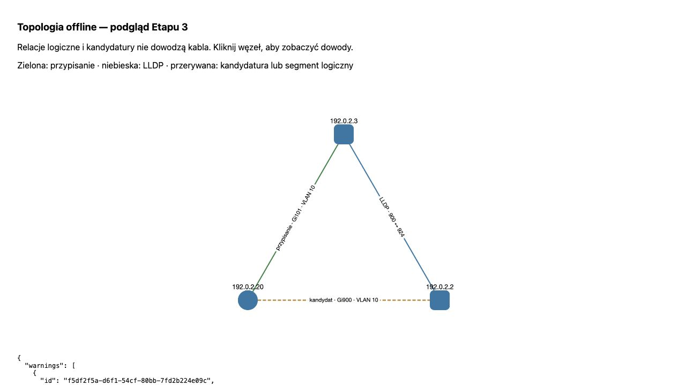

# Raport Etapu 3 — topologia i historia

Data: 23 października 2026 r. Wersja: mapper-sieci 0.3.0. Status: implementacja oraz odbiór techniczny offline gotowe; wynik oczekuje na zatwierdzenie użytkownika. Zgoda na kodowanie: „zatwierdzam koduj”. Podstawa: [ADR-003](../decisions/ADR-003-topologia-i-historia.md).

## Wykonanie

- Pure offline engine: segmenty i endpointy lokalne, punkty odczytu, LLDP, kandydaci i przypisania portów. NetworkX wykrywa cykle/redundancję; sam cykl nie oznacza aktywnej pętli.
- Korelacja ARP/FDB/IF/bridge/VLAN/LLDP z jawnie znanym kontekstem i czasem. Bridge port ≠ ifIndex ≠ localPortNum; FDB ID nie zastępuje VLAN. VLAN-y tagowane/nietagowane i PVID pozostają metadanymi portu z dowodami.
- Stabilne ID izolowane per projekt/kontekst. Zachowane konflikty IP/MAC, współdzielony MAC/proxy ARP, nieznany chassis i alternatywy portów. Brak samodzielnego rozstrzygania po liczbie MAC-ów.
- Confidence high/medium/low/unknown, powody, identyfikatory obserwacji, okno 300 s. Cache bez wieku, trunk lub wiele MAC obniża ocenę; połączenie nadal może oznaczać urządzenia za portem.
- Historia pierwszej obserwacji, świeżej odpowiedzi/powrotu, dłuższego braku obserwacji, potwierdzonej zmiany portu, konfliktu i podejrzenia flappingu. Idempotentny replay, osobne wersje reguł, brak niejawnego przeliczania wstecz istniejącej historii.
- SQLite v2: entity_registry, topology_results, history_events; spójny backup przed migracją i transakcja z rollbackiem. Źródłowe fakty i format snapshotu v1 zachowane. Historia 90 dni nie kaskaduje przy 7-dniowej retencji cykli; zachowany checkpoint grafu/reguł.
- CLI topology build/export/view oraz history; podgląd lokalny Dash/dash-cytoscape bez CDN i kolektorów. NetworkX dodano do zależności, podgląd jako opcjonalny zestaw preview. Zainstalowano wyłącznie własny pakiet editable, bez sieci i zmiany bibliotek. Uzupełniono teksty licencji 30 dodatkowych zainstalowanych dystrybucji, 56 plików/not.

## Weryfikacja

| Próba | Wynik |
|---|---|
| 15 wcześniejszych + 11 nowych testów krytycznych | 26/26 OK, około 0,6 s, bez infrastruktury CI |
| LAN bez SNMP, incomplete neighbor, brak zgadywanych kabli/VLAN | OK |
| 2 switche, host w FDB liścia i uplinku, LLDP subtype/mapowanie | Poprawny port liścia 101, bridge 12, VLAN 10; uplink 900 zachowany jako kandydat |
| Współdzielone FDB, konflikt portów, stary cache/rozbieżność czasu | Alternatywy/obniżenie confidence; bez fałszywej zmiany portu |
| Projekty, VRF, proxy ARP, zmiana MAC przy tym samym IP | Brak nieuprawnionego scalania |
| Niepełny cykl, błąd i zmiana zakresu | Brak fałszywego zwiększania licznika braku odpowiedzi |
| 3 właściwe cykle przez ≥30 min i powrót | Zdarzenie observation-only oraz returned, bez deklaracji odłączenia |
| Naprzemienne mocne porty i cykl grafu | Odrębne podejrzenie flappingu i ostrzeżenie o grafie |
| Migracja/backup, wymuszony błąd SQL, idempotencja/restart | v2 poprawna, błąd wycofuje do v1; brak duplikacji zdarzeń |
| Retencja źródeł | Historia i checkpoint pozostają, FK check OK |
| Podgląd WSGI test client | HTML/layout, wszystkie wskazane lokalne zasoby i callback szczegółów OK |
| Przeglądarka, syntetyczna topologia | 3 węzły, typy/etykiety relacji, port/VLAN i szczegóły klikniętego hosta potwierdzone wizualnie |
| CLI build/export/history/import, rzeczywisty zapis LAN | OK, bez nowych sond i bez prób połączeń wychodzących |
| git diff --check + kontrola nowych plików | Brak błędów w przekazanym kodzie/dokumentach |

Komenda testów: `PYTHONDONTWRITEBYTECODE=1 ./.venv/bin/python -m unittest discover -s tests/critical -v`. Spójność: `PRAGMA integrity_check=ok`, `PRAGMA foreign_key_check` bez wpisów. Ze względu na zastany stan repozytorium (pliki nieśledzone) dodatkowo sprawdzono składnię i białe znaki plików wdrożenia; pusty git diff sam nie był dowodem przeglądu tych plików.

## Istniejący LAN — odbiór wyłącznie offline

Wejście: zachowany wynik Etapu 2, 534 obserwacje; żadnego nowego skanu. Wyjście: **14 endpointów + 1 lokalny interfejs + 1 segment, 15 logical_membership**, bez attachment i bez wymyślonych portów/VLAN-ów. 22 zdarzenia: 14 first_observed i 8 fresh_response. Pierwszy graf nie potwierdza historii wielocyklicznej w rzeczywistym LAN — tę regułę sprawdzono syntetycznie.

Najpierw sprawdzono kopię przez SQLite backup, potem główny projekt danych. Hash źródłowego snapshotu przed/po identyczny. Ponowne budowanie i otwarcie repozytorium dają ten sam wynik i liczbę zdarzeń. Replay do innego projektu ma inne ID i jawne origin=imported. Audyt Pythona blokował socket.connect/sendto/getaddrinfo; liczba prób: 0. Podgląd przeglądarkowy to osobna próba HTTP wyłącznie na 127.0.0.1.

Prywatne receipt, eksporty i ścieżka backupu pozostają poza repozytorium: `~/Library/Application Support/MapperSieci/acceptance/stage3-20261023-3h2kgzdr/`. Do publicznego przykładu trafiły wyłącznie syntetyczne adresy 192.0.2.0/24 i lokalnie administrowane MAC.

## Granice potwierdzenia

SNMP/SSH na rzeczywistym sprzęcie i Windows nie były testowane ponownie ani uznane za odebrane. Brak źródłowych danych dla VRF/LAG/stack/MLAG oznacza jawny brak rozstrzygnięcia; nazwy Po1 i podobne nie tworzą członków grupy. Nie ma bazy OUI ani aktywnego DNS w tym etapie.

Automatyczny dłuższy brak obserwacji ograniczono do wcześniej odpowiadających hostów ICMP, z identycznym zbiorem celów i kompletnymi cyklami. Cache ARP/FDB sam nie dowodzi obecności ani zniknięcia. Mocne zmiany portów wymagają świeżych, zgodnych dowodów; cache bez wieku daje najwyżej medium. Domyślne nieznane VRF punktów odczytu nie są scalane między switchami. To konserwatywne ograniczenia dowodów.

Brak nowej walidacji całej macierzy producentów, dużej skali i instalatora. Pełny panel, filtry, wygodna historia i graficzne eksporty produktu pozostają Etapem 4. Podgląd Etapu 3 nie zastępuje tego odbioru. [Poradnik uruchomienia](../poradniki/ETAP_3_URUCHOMIENIE_I_ODBIOR.md).

Końcowe sprawdzenia po instalacji: 26/26 testów (0,714 s), `pip check` — No broken requirements found, 79 plików objętych kontrolą składni/białych znaków. Osobna próba zajętego portu 8052 odrzucona bez wywołania przeglądarki; automatyczne otwieranie przetestowano atrapą przeglądarki na rzeczywistym lokalnym serwerze 8053 — dokładnie `http://127.0.0.1:8053`. Zapisany graf głównego LAN i przykładu jest równy świeżej czystej derywacji. Serwery prób zakończono po odbiorze.

