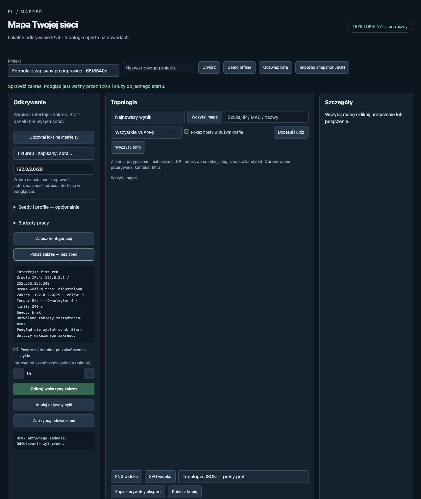

# Poprawki po rzeczywistym odbiorze LAN — 0.4.1

Data: 25 października 2026 r. Status: wdrożono, odbiór techniczny offline OK; wynik do zatwierdzenia. Użytkownik zlecił „ok dzialaj wedlug planu”. Zakres: trzy ustalenia z [odbioru LAN 0.4.0](../etap-4/ODBIOR_LAN_2026-10-25.md), decyzja przed kodem: [ADR-008](../decisions/ADR-008-poprawki-po-odbiorze-lan.md). [Wyniki zbiorcze](ODBIOR_2026-10-25.json).

## Co poprawiono

| ID | Zmiana | Dowód |
|---|---|---|
| LAN-01 | MAC rozgłoszeniowy, grupowy i zerowy nie tworzy endpointu ani przypisania FDB. Lokalny adres sieci/broadcast wyznaczamy z zaobserwowanej maski interfejsu, nie z węższego zakresu sond; /31 i /32 zachowują adresy końcowe. Nie odrzucamy automatycznie końcówki .255. | Testy ARP/FDB i /23,/24,/31,/32; replay rzeczywistego snapshotu usuwa błędny endpoint. |
| LAN-02 | Własny IPv4 pozostaje jednym local_interface w dokładnym kontekście. Jego cache trafia do dowodów i neighbor_mac_claims, bez udawania zweryfikowanego MAC karty. | Replay usuwa duplikat; test zachowuje wiele MAC i IP_MAC_CONFLICT, odrębny VRF pozostaje osobny. |
| LAN-03 | Zapisany interfejs ładuje się razem z opcją dropdown. Zapis/preview/start wymagają formularza bieżącego projektu. Niekompletna para interfejs/CIDR daje błąd przed zapisem. Zastąpiony callback przycisku startu usunięto, aby nie konkurował z kontrolą gotowości. | Prawdziwa przeglądarka: bazowy panel z HEAD odtworzył NO_SOURCES_CONFIGURED; poprawiony wykonał preview od razu. Wyłącznie dane syntetyczne, bez sond. |

LOCAL_IP_NEIGHBOR_CLAIM jawnie ostrzega, że wpis cache dla lokalnego adresu nie potwierdza MAC karty i może wskazywać konflikt. Szczegóły pokazują te roszczenia oddzielnie od MAC urządzenia. Nie odczytywano nowych danych sprzętowych ani nie ukryto możliwego konfliktu przez automatyczne scalenie MAC.

Reguły **2:skew=300** zastępują domyślne reguły 1. Zapisane stare grafy i zdarzenia pozostają nietknięte. Nowe buildy odtwarzają zachowane źródła chronologicznie w oddzielnej historii wersji; nie generują zniknięć na granicy reguł. Panel wyświetla wersję i historię wybranego grafu, CLI domyślnie reguły 2 z oknem 300 s; history --rules-version pozwala odczytać wcześniejsze reguły. Po retencji nowa historia rozpoczyna się od najstarszego zachowanego źródła. Źródła v1 i SQLite v2 bez migracji.

## Odbiór

- macOS 26.6.2 ARM64, Python 3.13.0, ten sam zestaw bibliotek. Bez nowych zależności, CI/CD i zmian kolektorów.
- Polecenie: `./.venv/bin/python -m unittest discover -s tests/critical -v`: **54 testy krytyczne OK**. Pięć nowych grup chroni wyłącznie wykryte luki i granicę wersji; testy blokują połączenia sieciowe. Pierwsza próba miała błąd niekompletnego syntetycznego payloadu (brak wymaganego state); fixture poprawiono przed powtórzeniem.
- Prywatna spójna kopia SQLite rzeczywistego LAN, bez nowych sond: **4 endpointy + interfejs + segment = 6 węzłów, 5 relacji logicznych**. Dwa hosty mają świeżą odpowiedź, dwa tylko cache. Port/VLAN nadal nieustalone. Jedno ostrzeżenie o niezweryfikowanym lokalnym MAC z cache.
- Źródła i stare wyniki bez zmian; powtórny build identyczny i bez dodatkowych zdarzeń. Historia aktualnych reguł: 6 zdarzeń; stara pozostaje dostępna osobno. SQLite integrity_check=ok, foreign_key_check bez błędów.
- Nowe JSON/CSV topologii z tego replay zapisano prywatnie. Oryginalnego projektu ani poprzedniego raportu nie zastąpiono poprawionym wynikiem wstecz. Niezmienność danych potwierdzono na kopii; wszystkie rzeczywiste adresy/MAC i eksporty pozostają poza repozytorium.
- Odbiór formularza w przeglądarce porównał ten sam zapisany typ konfiguracji z bazowym kodem i poprawką. Bez ręcznego poprawiania pól uzyskano prawidłowy zakres. Kontroler wykorzystywał atrapę adaptera i blokadę kolekcji. Po odbiorze zamknięto karty i własne serwery.



## Jak użyć poprawki

Zatrzymaj stary proces panelu i uruchom aktualny kod. Samo uruchomienie oraz przycisk „Wczytaj mapę” nie skanują sieci. Build wyliczy reguły 2 dla zapisanych snapshotów; wersja pojawi się obok daty mapy. Pierwsze wczytanie większej historii może potrwać dłużej, bo reguły 1 nie są cache dla reguł 2.

```sh
./.venv/bin/mapper --version
./.venv/bin/mapper panel --offline
```

Oczekiwana wersja to 0.4.1. Wybierz istniejący projekt i „Wczytaj mapę”. Aby przeliczyć w CLI bez sond, zastąp PROJECT_UUID identyfikatorem istniejącego projektu:

```sh
./.venv/bin/mapper topology build --project PROJECT_UUID
./.venv/bin/mapper history --project PROJECT_UUID
./.venv/bin/mapper history --project PROJECT_UUID --rules-version '1:skew=300'
```

Nie uruchamiaj collect --run na potrzeby replay. Zgoda na wcześniejszy jednorazowy skan została wykorzystana; nowe odczyty aktywne wymagają własnego zakresu.

## Granice wyniku

To regresja zapisanych danych i formularza, nie kolejny skan ani pełny odbiór MVP. Nie powtórzono PNG/SVG dla rzeczywistego LAN, fizycznego odłączenia Internetu, Windows/NTFS, sprzętu SNMP/SSH ani pomiaru łącznego RAM. Wcześniejsze raporty nadal opisują faktycznie wykonane próby, a nie przyszły artefakt.

Plan Etapu 5 pozostaje propozycją. Próba zapisania go jako zaakceptowanego została odrzucona przez automatyczny przegląd zakresu; dokumentów zatwierdzenia nie zmieniono. Wstępne pobranie dokładnych kół z PyPI nie dało kompletnego wheelhouse: dash-cytoscape 1.0.2 nie ma dostępnego zgodnego koła w tym zapytaniu. Nie zbudowano instalatora/ZIP ani nie zmieniono zależności. Do przyszłego pakowania należy sprawdzić zachowane lokalnie koło tej samej wersji i jego pochodzenie zamiast obniżać wersję. Nie wykonano commita, pushu ani publikacji.
