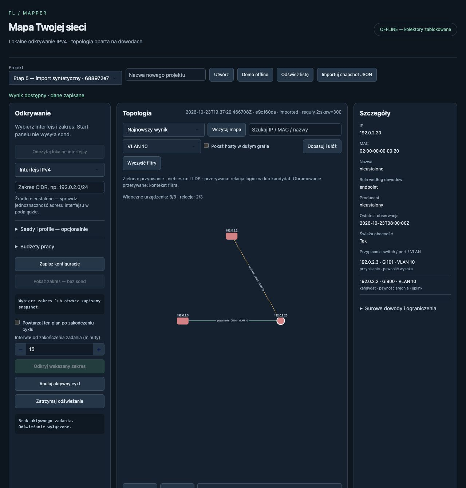

# Etap 5 — kandydat 0.5.0rc1

Data: 25 października 2026 r. **Pakowanie wdrożone, odbiór techniczny macOS wykonany; pełny Etap 5 i MVP pozostają otwarte.** Zgoda: „Tak, zatwierdzam wdrożenie Etapu 5”, na pytanie o ZIP z lokalnymi zależnościami i odbiór instalacji, bez publikacji i nowych skanów. [ADR-007](../decisions/ADR-007-pakowanie-i-odbior-wydania.md), [plan](../poradniki/ETAP_5_ODBIOR_I_PAKOWANIE_MVP.md), [karta prób](KARTA_ODBIORU_ETAP_5.md).

## Dostarczone pliki

- `packaging/bundle.py`: weryfikacja manifestu/sum, platformy i Python 3.13; świeże venv, wyłącznie lokalne koła z pinami i hashami; marker poprawnego zakończenia; start bez pobierania.
- `packaging/build_bundle.py`: budowa archiwum z jawnych wejść, kontrola SQL/CSS, metadanych i zależności dla docelowego systemu, resolver bez indeksu, manifest, sumy i ZIP. Nie pobiera bibliotek i zawsze oznacza wynik jako wewnętrzny kandydat, nie gotowe wydanie.
- `packaging/maintenance.py`: krótki odbiór instalacji oraz spójny prywatny backup SQLite/config z blokadą projektu. Nie kopiuje wcześniejszych eksportów/obrazów; instrukcja wymaga ich osobnego zachowania. Nie wykonuje kolekcji.
- Skrypty instalacji/startu macOS i Windows, gotowa instrukcja w każdej paczce; platformowe requirements.lock w repozytorium. Bez nowych bibliotek runtime, CI/CD, interpretera w ZIP, konfiguracji systemu i automatycznej aktualizacji.
- Archiwa i sumy są lokalnie w `dist/etap-5-2026-10-25/`, poza śledzonymi plikami Git. Każde ma **51 kół** (własny pakiet i 50 zależności), źródła dokładnych dystrybucji i zasobów oraz 230 zachowanych tekstów/not z inwentarzem. Archiwum nie zawiera venv, .git, old, danych operatora ani prototypów.

| Platforma | ZIP | SHA-256 |
|---|---|---|
| macOS ARM64 | [mapper-sieci-0.5.0rc1-macos-arm64.zip](../../dist/etap-5-2026-10-25/mapper-sieci-0.5.0rc1-macos-arm64.zip) | 7319994037e96a2d8e512f0a23287ac400449152988df91800fb9279097de962 |
| Windows x64 | [mapper-sieci-0.5.0rc1-windows-x64.zip](../../dist/etap-5-2026-10-25/mapper-sieci-0.5.0rc1-windows-x64.zip) | ea7a6e647ec40d8b33dbf8ffa03c677e3972e7ac32126eb789f8ae4428d577c9 |

Hash własnego wheel: `c6cbf011753ce53e37c96a54ded121da009345b83d6ae975e7bc27aab4f93e99`. Funkcjonalne próby wykonano z tego wheel; końcowy ZIP zachowuje ten sam kod aplikacji i zestaw kół. Końcowe doprecyzowanie komunikatu brakującego pliku dotyczy samodzielnego instalatora, objętego końcową regresją. Commit bazy i dirty state zapisano w manifestach; nie wykonano nowego commita/tagu/pushu.

## Odbiór macOS

Stanowisko: **macOS 26.6.2 ARM64, Python 3.13.0**, przeglądarka wbudowana w Codex. Numer silnika przeglądarki nie został udostępniony przez narzędzie; nie dopisano domysłu. Dowody zbiorcze: [ODBIOR_2026-10-25.json](ODBIOR_2026-10-25.json).

1. Zbudowano własny wheel poza repozytorium i sprawdzono obecność dwóch migracji SQL, panelu/CSS, metadanych i MIT. Koła z PyPI porównano z hashami oficjalnych plików. Dash-cytoscape 1.0.2 zbudowano offline z oficjalnego archiwum źródłowego po weryfikacji jego SHA-256; wersji nie zmieniono.
2. ZIP rozpakowano poza checkoutem do ścieżki zawierającej spacje i polskie znaki **przed** instalacją. Instalator utworzył nowe venv, zainstalował 51 lokalnych kół przez --no-index/--only-binary/--require-hashes. Import mapper pochodził z jego site-packages, wersja modułu i dystrybucji 0.5.0rc1; pip check OK. Nie polegał na developerskim src/ ani PYTHONPATH.
3. **58 testów krytycznych OK**: z checkoutu i z interpretera zainstalowanego wheel (testowe fixture'y i skrypty pakowania są czytane z repozytorium). Osobny receipt/demo dowodzi uruchomienia aplikacji spoza checkoutu. Cztery nowe grupy chronią manifest/hash/brak pliku, niebezpieczne ścieżki/linki, odmowę nadpisania venv, warunkowe zależności Windows i spójny backup.
4. Rzeczywiste kopie paczki z uszkodzonym kołem i brakującym kołem odmówiły instalacji **przed utworzeniem venv**. Powtórny install zachował istniejące środowisko. Końcowy komunikat wskazuje nazwę brakującego pliku. Nie uszkodzono wcześniejszej instalacji.
5. Z zainstalowanej paczki: demo, import snapshotu, graf, historia aktualnych reguł, szczegóły hosta IP/MAC/Gi101/VLAN10, rozróżnienie kandydata Gi900/uplink. Filtr VLAN10 ograniczył 3 relacje do 2. Pięć eksportów danych zapisano prywatnie. PNG obejrzano — pełne trzy węzły i etykiety; SVG ma poprawny XML oraz etykiety trzech węzłów. Eksporty dotyczą danych syntetycznych.
6. DOM wskazał 12 lokalnych odwołań do skryptów/CSS/favicon, bez CDN. To nie jest fizyczny test bez Internetu/cache. Obsługa zdarzenia pobrania w automatyzacji dwukrotnie przekroczyła zadany timeout (wielominutowe blokowanie narzędzia); zapisane pliki sprawdzono niezależnie. Nie uznano tego czasu za pomiar aplikacji.
7. Własny serwer na 8055; druga własna instancja odmówiła startu z PANEL_PORT_UNAVAILABLE i kodem 2. Pierwszego procesu nie zatrzymano ani nie otwarto cudzej instancji. Po odbiorze zamknięto kartę i własny serwer przez Ctrl+C. Start nie wykonywał skanu; tryb offline blokował kolektory.
8. Techniczna wymiana na zgodne, zmienione kopie **Paramiko, scp i autocommand** w testowym venv: import działał, wszystkie oryginalne pliki przywrócono. To dowód możliwości wymiany w tym układzie, nie pełny audyt praw wszystkich plików.
9. Aktualizacja 0.4.0 → 0.5.0rc1: osobne stare środowisko, spójna prywatna kopia syntetycznej bazy, replay nowymi regułami. Źródła i stare wyniki zachowane, niezmieniony oryginał nadal odczytywany przez 0.4.0. Nie testowano cofania nowej bazy przez nadpisanie jej starszym programem.
10. Retencja zachowała chroniony snapshot; mały limit zablokował nowy cykl/eksport i nie skasował wcześniejszych eksportów. Symulowany ENOSPC podczas zapisu config zachował oryginał i usunął plik tymczasowy. Użyto 1 MiB fixture, bez zapełniania dysku i bez zmian danych operatora.

## D14 i zasoby

Zainstalowany wheel: **50 switchy, 1000 hostów, 20 VLAN, 50 tys. obserwacji**. Import+korelacja **5,773 s**, projekcja infrastruktury **0,002 s**. Pełny graf 1050/1049, domyślny widok 50/49. Od kliknięcia „Wczytaj mapę” do widocznego licznika **1,549 s**, razem z opóźnieniem automatyzacji. Użyto już przeliczonego snapshotu, zgodnie z przepływem panelu.

Peak RSS procesu importu/korelacji **539 639 808 B**. **Nie zmierzono łącznego RAM aplikacja+karta**, ponieważ karta działa w współdzielonym środowisku przeglądarki narzędzia. R02 pozostaje niewykonane; sam ten RSS nie zalicza celu 1,5 GB. Nie utożsamiamy testowego API z pomiarem fizycznej sieci.

## Materiały komponentów

Zebrano 50 źródłowych dystrybucji Pythona i własne źródła, materiały SheetJS 0.18.5 oraz wskazanych Font Awesome. Wersję SheetJS potwierdzają rzeczywisty async-export.js i package-info Dash, a nie sam komentarz licencyjny. Źródła npm porównano z integrity. Uzupełniono pySerial, wewnętrzne noty setuptools, pełne MPL/GPL/LGPL oraz tekst OpenSSL odpowiadający wersji 4.0.3 widocznej w binariach. Oryginalny historyczny third_party_licenses/ zachowano bez zmian; nowe materiały i ich pochodzenie są w paczkach.

**Otwarte pozostają pełna weryfikacja pochodzenia/atrybucji natywnych komponentów (w tym Rust/libffi) oraz kompletności zasobów JS/fontów.** Samo zebranie źródeł i not nie zamyka L01. Paczki są wewnętrznymi kandydatami do odbioru; nie oznaczono ich jako gotowych do przekazania klientom ani nie opublikowano.

## Pozostała praca

[Macierz wsparcia](MACIERZ_WSPARCIA.md) i [karta prób](KARTA_ODBIORU_ETAP_5.md) zawierają rzeczywiste stany. Operator ma Windows 10 lub 11, ale nie otrzymano jeszcze receipt z tego stanowiska. Instrukcję i gotowy ZIP przygotowano do tej próby. Windows/NTFS/źródło IPv4 i drugie zwykłe konto pozostają niewykonane. Nie wykonano nowych odczytów LAN, sprzętu SNMPv2c/v3/SSH ani znanej fizycznej topologii, odłączenia Internetu/cache ani łącznego RAM. Tych pozycji nie zastępują wcześniejsze zatwierdzenia i próby syntetyczne.

Pełnego Etapu 5 nie zamknięto. Nie ograniczono automatycznie macierzy D01 ani wymagań MVP. Kolejny krok: receipt instalacji i krótki odbiór na dostępnym Windows, następnie dostępne pozostałe próby oraz zamknięcie materiałów konkretnego wydania. Aktywne odczyty wymagają osobnego, dokładnego zakresu; obecna zgoda ich nie obejmuje.
